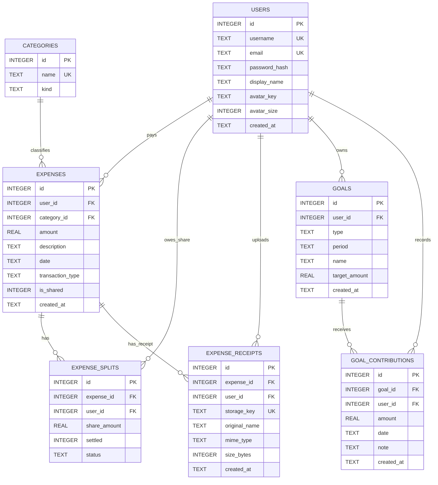

# CampusWallet / OffCampus presentation notes

## PowerPoint images

These 16:9 slides are exported at 1920 × 1080 pixels. Insert the PNG files directly into PowerPoint, or use the SVG versions for resolution-independent scaling.

- [Architecture slide — PNG](architecture-slide.png) · [SVG](architecture-slide.svg)
- [Database model slide — PNG](database-model-slide.png) · [SVG](database-model-slide.svg)
- [Application wireframes — PNG](wireframes.png) · [SVG](wireframes.svg)

## Database relationship diagram

Paste this Mermaid diagram into a Mermaid editor or a Markdown viewer that supports Mermaid. It shows the tables used by the current SQLite schema, including profile fields stored on `users`.



### How to explain the relationships

- A user can record many expenses; each expense has one payer and one category.
- A shared expense can have several split rows. Each split links one expense to one roommate and stores that roommate's proposed share, review status, and settlement state.
- Receipts belong to an expense and its owner. Receipt files are stored privately; the database stores their metadata and storage key.
- A user can create goals. Contributions belong to a goal and are recorded by a user.
- `expense_splits` and `goal_contributions` are linking/detail tables: they turn one-to-many relationships into individual records that can be reviewed and updated.
- Category `kind` and transaction `transaction_type` distinguish income from expenses. Monthly rewards are calculated from account activity and goals, so they are not stored in a separate table.

## What the web app looks like

The browser opens on a sign-in and registration card. After sign-in, the left navigation switches between five client-rendered views:

1. **Overview:** this month's spending, amounts owed, category bars, and recent activity.
2. **Expenses:** a form and activity list. The form supports category, date, optional receipt, and proposed roommate shares.
3. **Roommate balance:** pending split approvals plus open debts, with actions to accept, decline, or settle a share.
4. **Goals:** savings targets or spending budgets, with recorded contributions and progress.
5. **Profile:** display name and a private profile image.

The same HTML page stays loaded as the user moves between views. JavaScript calls the API with `fetch()`, then updates the page's DOM with the JSON response.

## Architecture and course connection

```text
Browser UI (127.0.0.1:5173)
    HTML + CSS + JavaScript
          | fetch() / JSON, CORS enabled
          v
REST API (127.0.0.1:3000)
    Express routes + authentication + validation
          | parameterized SQL
          v
SQLite database (backend/data/offcampus.sqlite)
```

- **Vaja 4:** the seminar frontend uses client-side rendering, DOM updates, `fetch()`, REST endpoints, JSON responses, and CORS between two different origins (the ports differ).
- **Vaja 5:** that exercise develops an Android app and is a separate client platform from this browser-based seminar app.
- **Vaja 6:** that exercise connects the Android app to a REST web service. The same API concepts used here—HTTP requests, JSON, and asynchronous communication—apply to that client too.

## Suggested presentation sequence

1. Show the sign-in screen, then enter with the demo account.
2. Point out the monthly summary, category breakdown, and recent expenses.
3. Add a shared expense and show that a roommate receives a pending split.
4. Switch to the roommate account, accept the share, then demonstrate settling it.
5. Show the ER diagram and trace `users → expenses → expense_splits` for the shared expense.
6. Finish with the two server addresses and explain the browser-to-API `fetch()` request.
